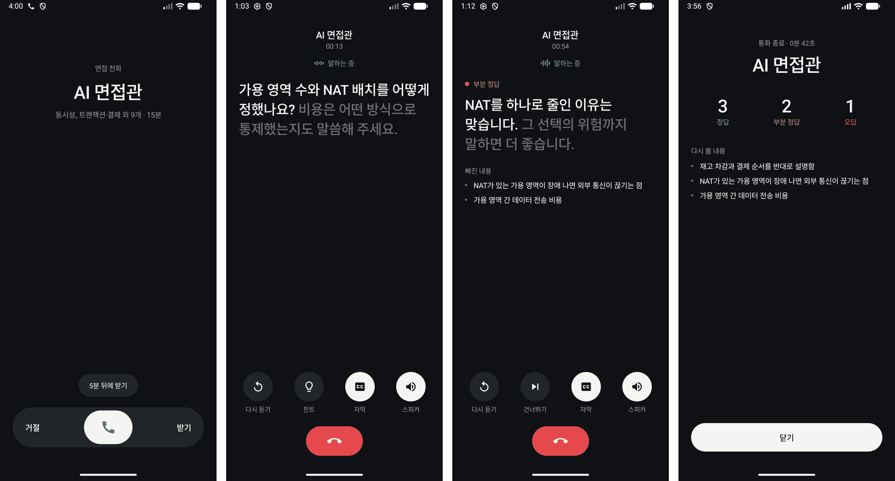
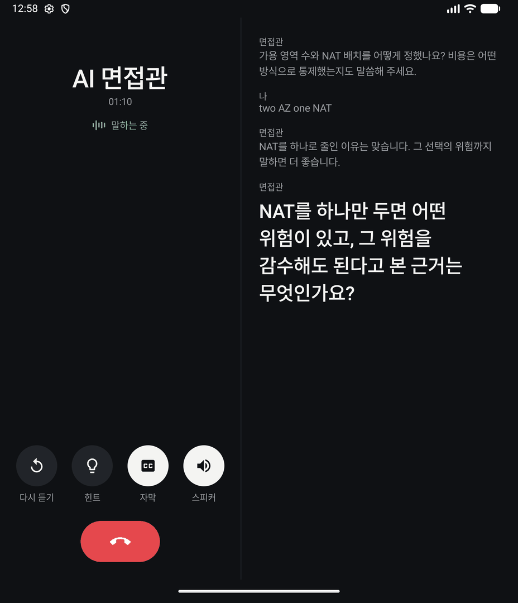

# AI Voice Interview

매일 아침 전화처럼 울리는 알림을 받으면, AI가 음성으로 기술 면접을 진행하는 개인용 Android 앱입니다. 질문은 제가 만든 프로젝트 [FlowTicket](https://github.com/gumwoo/first_come-first_served)의 설계 기록과 장애 기록에서 나옵니다.

지금은 전화 알람까지 만든 단계입니다. 폴드에서 Wi-Fi와 모바일 데이터로 각각 10분 동안 말로 면접을 끝까지 진행해 봤고, 화면이 꺼져 있어도 시험 전화가 울려 받을 수 있습니다. 틀린 내용을 다시 묻는 복습은 다음 단계에서 만듭니다.



왼쪽부터 잠금 화면 수신, 질문 읽는 중, 피드백 읽는 중, 통화 종료입니다. 읽은 문장은 밝게, 아직 읽지 않은 문장은 어둡게 보여 줍니다. 폴드를 펼치면 왼쪽은 통화, 오른쪽은 대화 자막으로 나뉩니다.



Android 17 에뮬레이터에서 찍은 실제 앱 화면이고, 질문과 점수는 화면 확인용 예시 데이터입니다.

## 왜 만드나요

설계 문서를 쓰고 코드를 설명할 수 있다고 생각해도, 막상 말로 하면 막히는 경우가 많습니다. 왜 그 방식을 골랐는지, 다른 방법은 왜 버렸는지를 입으로 설명하는 일은 눈으로 복습해서는 잘 늘지 않습니다.

혼자 연습하면 세 가지가 어렵습니다. 매일 같은 시간에 시작하기 어렵고, 내 답에서 무엇이 빠졌는지 알기 어렵고, 틀린 내용을 나중에 다시 말해 보지 않게 됩니다. 이 앱은 이 세 가지를 해결하려고 합니다.

## 어떻게 동작하나요

평일 오전 7시 30분이 되면 폰에서 알림이 울립니다. 받기를 누르면 AI가 질문을 하나 읽어 주고, 제가 말로 답하면 음성 인식 결과가 PC 서버로 갑니다. Claude가 답을 채점한 뒤 다음 질문이나 해설을 돌려주면 폰이 읽어 줍니다. 이렇게 15분쯤 진행합니다. 시간과 요일은 앱에서 바꿀 수 있고, 틀렸거나 일부만 맞힌 내용을 다음 면접에 다시 묻는 기능은 다음 단계에서 만듭니다.

의도한 대화는 이런 모습입니다. 실제 출력이 아니라 설계용 예시입니다.

> **면접관:** 좌석 선점에 Redis 분산락 대신 DB 조건부 UPDATE를 쓴 이유를 설명해 보세요.
>
> **나:** 영향받은 행 수를 확인하면 한 명만 성공하니까 초과판매를 막을 수 있어서요.
>
> **면접관:** 조건부 UPDATE가 동작하는 방식은 맞습니다. 그런데 분산락을 쓰지 않은 이유가 아직 나오지 않았어요. 락의 TTL이 먼저 끝나면 어떤 문제가 생길까요?

정답과 오답만 가르지 않습니다. 일부만 맞으면 빠진 부분을 다시 묻고, 모른다고 하면 설명한 뒤 이해했는지 확인합니다. 음성 인식이 불확실하면 채점하지 않고 되묻습니다.

## 구조

```text
갤럭시 앱     알람, 음성 인식, 음성 합성, 면접 화면
    │
    │  Tailscale 사설망
    │
PC 서버       Spring Boot, PostgreSQL (Docker Compose)
    │
    │  질문 생성, 채점, 해설, 꼬리질문
    │
Claude API
```

앱은 Kotlin과 Jetpack Compose로, 서버는 Java 17과 Spring Boot로 만듭니다. 스키마는 Flyway로 관리하고, 테스트는 Testcontainers의 실제 PostgreSQL로 돌립니다. 대상 기기는 갤럭시 Z 폴드 8(Android 17)이고, 서버는 24시간 켜 두는 제 Windows PC입니다.

## 설계하면서 정한 것들

### 전화처럼 보이지만 전화가 아닙니다

실제로 전화를 걸려면 전화번호 임대와 발신 요금이 필요한데, 혼자 쓰는 학습 앱에는 맞지 않습니다. 그래서 앱 안에 수신 화면을 만들고, 대화는 데이터 통신으로 합니다.

잠금 화면에는 전화 전용 화면만 띄웁니다. 전화가 끝나면 닫히므로 홈과 설정은 잠금 위에 보이지 않습니다. Android 14부터 전체 화면 알림이 통화·알람 앱 중심으로 제한되어 기기 설정에 따라 꺼질 수 있는데, 그때는 권한을 우회하지 않고 알림으로 울린 뒤 일정 화면에서 안내합니다. 벨소리는 알림 채널 소리로 내서, 앱이 꺼져 있어도 시스템이 재생합니다.

### 알람은 서버가 아니라 폰이 울립니다

서버에서 푸시를 보내면 PC에 문제가 있을 때 알림도 함께 사라집니다. 폰에서 `AlarmManager`로 예약하면 서버가 꺼져 있어도 알림은 울리고, 받은 뒤에 연결 실패를 알려 줄 수 있습니다. 같은 이유로 스케줄의 원본은 앱 하나로 두고, 서버에는 저장하지 않습니다.

### 끼어들기는 포기하고 턴제로 시작합니다

사람과 통화하듯 말을 끊고 끼어드는 대화는 자연스럽지만, 지금 풀어야 할 문제가 아닙니다. Android `SpeechRecognizer`는 계속 켜 두는 용도가 아니어서, 질문을 다 읽은 뒤 한 번씩 인식을 시작합니다. WebRTC나 별도 음성 API 없이 시작할 수 있고, 인식 결과를 제출 전에 고칠 수도 있습니다.

### Claude 호출은 트랜잭션 밖에서 합니다

모바일 환경에서는 응답을 받기 전에 연결이 끊겨 같은 답변을 다시 보내는 일이 생깁니다. 그때마다 Claude를 호출하면 크레딧을 낭비하고 채점도 두 번 저장됩니다. 그래서 답변을 먼저 저장해 커밋한 뒤 트랜잭션 밖에서 Claude를 호출하고, 앱이 만든 요청 ID로 재전송을 구분합니다. 외부 API를 기다리는 동안 DB 커넥션을 쥐고 있지 않게 하는 효과도 있습니다.

### 채점은 믿기 전에 평가합니다

이 앱에서 가장 어려운 문제는 통화 화면이 아니라 채점 품질입니다. 틀린 해설을 음성으로 듣고 넘어가면 잘못 외우게 됩니다. 그래서 음성과 알람보다 텍스트 면접을 먼저 만들고, 프로젝트 문서와 코드로 대조한 답변 예시 30건 이상과 AI의 판정을 비교합니다. 이 기준을 넘기 전에는 앱을 만들지 않습니다. 모델이 함께 내놓는 확신도 값은 자기 평가일 뿐이므로 정확도의 근거로 쓰지 않습니다.

처음에는 비용이 낮은 Claude Haiku로 끝까지 가고 마지막에 Claude Sonnet으로 바꿀 계획이었습니다. 하지만 평가 기준을 실행 전에 정해 두고 재 보니, Haiku는 프롬프트를 세 번 고쳐도 확인용 일치율이 67~75%에 머물러 기준인 80%를 넘지 못했습니다. 같은 평가셋에서 Sonnet은 92%가 나와서, 계획을 바꿔 Sonnet을 기본 모델로 정했습니다. 다만 확인용 예시는 12건이고 측정도 한 번이라, 이 수치는 모델 선택의 근거이지 품질 보증은 아닙니다.

### 질문은 저장해 두고 재사용합니다

매번 질문을 생성하면 비용이 들고, 나오는 질문을 미리 검토할 수도 없습니다. 프로젝트 문서와 코드로 대조한 시드 질문을 먼저 쓰고, 후보가 없을 때만 생성해서 저장합니다. 시드에는 근거 문서와 기준 커밋을 남기고, 생성한 질문은 검증되지 않은 것으로 구분합니다.

FlowTicket 문서에는 지금은 대체된 결정도 섞여 있습니다. Kafka를 제거하기 전에 쓴 기록이 대표적인데, 이런 내용은 현재 상태를 기준으로 출제합니다.

### 혼자 쓰니까 뺀 것들

사용자가 한 명이므로 다중 사용자, 역할 권한, 기기 페어링, Google Play 배포는 만들지 않습니다. 하루 면접 횟수 상한도 처음에는 넣었지만 연습만 막아서 뺐고, DB 백업도 두지 않습니다. PC 디스크가 고장 나면 면접 기록은 사라지지만, 시드 질문은 저장소에 있어 다시 시작할 수 있습니다. 서버는 Tailscale 안에만 두고 인증은 고정 토큰 하나로 합니다. DB도 하나뿐이라 ID는 분산 ID 대신 `bigint`를 씁니다. 나중에 사용자가 늘면 다시 설계해야 하는 부분이고, 그 비용은 감수합니다.

## 실기기와 에뮬레이터에서 알게 된 것

문서를 읽고 예상한 것과 달랐던 문제들입니다.

- **연결이 시간 초과로 끝났습니다.** `targetSdk` 37부터 사설 주소 접속은 `ACCESS_LOCAL_NETWORK` 런타임 권한이 필요합니다. 오류 메시지가 따로 없어 네트워크 문제처럼 보였습니다.
- **한국어 음성 인식이 안 되는 것처럼 보였습니다.** 실제로는 기기 내 한국어 음성 팩이 내려받아져 있지 않았고, 앱이 요청하지 않았을 뿐입니다. 이제 앱을 켤 때 확인해 내려받기를 요청합니다. 시스템이 확인 창을 띄우므로 통화 중에는 묻지 않습니다.
- **잠금 화면에서 켜지면 화면이 비어 보였습니다.** 코드에서 잠금 위 표시를 켜던 방식에서, 전화 전용 화면을 두고 매니페스트에 선언하는 방식으로 바꾸니 해결됐습니다.
- **부재중 알림이 제때 뜨지 않았습니다.** 일반 알람은 시스템이 크게 늦출 수 있어 정확 알람으로 바꿨습니다.

## 아직 모르는 것

문서만으로 답할 수 없어서 실제로 해 봐야 아는 것들입니다.

- 매일 아침 일정 시각에 알람이 얼마나 정확히 울리는지, 배터리 절전 중에도 그런지. 지금까지는 시험 전화로만 확인했습니다.
- 음성 인식이 기술 용어를 얼마나 알아듣는지
- Tailscale 주소에도 Android 17의 `ACCESS_LOCAL_NETWORK` 권한이 필요한지. 에뮬레이터에서 PC로 가는 사설 주소는 이 권한이 없으면 연결되지 않았고, 폴드에서는 권한을 허용한 상태로만 써 봤습니다.
- 실제 말로 한 답변에서도 채점이 평가셋만큼 잘 맞는지

## 개발 순서

1. 서버 기반: 저장소, CI, DB 스키마, 토큰 인증
2. Claude 연결: 구조화된 응답, 타임아웃, 사용량 기록과 상한
3. 텍스트 면접: 세션과 턴 API, 시드 질문, 중복 제출 방지
4. 품질 평가: 평가셋으로 채점을 검증하고, 통과해야 다음 단계로 진행
5. 음성 앱: 음성 입출력, 폴드 화면 대응, 사설망 연결
6. 알람: 예약, 받기와 거절과 미루기, 권한 안내
7. 복습: 오답 재출제

각 단계의 완료 기준은 [개발 계획서](AI_Voice_Interview_Development_Plan.md) 10절에 있고, 진행 상황은 GitHub 이슈와 PR로 남깁니다.

## 실행 방법

서버를 띄우려면 Docker가 필요합니다.

`infra/.env.example`을 `infra/.env`로 복사해 비밀번호, 32자 이상의 API 토큰, Claude API 키를 채운 뒤 서버를 띄웁니다.

```bash
docker compose -f infra/compose.yaml up -d --build
```

```bash
curl http://localhost:18080/api/v1/health
```

환경 변수 `SPRING_PROFILES_ACTIVE=dev`를 주고 띄우면 `http://localhost:18080/dev/console`에서 브라우저로 면접을 시험할 수 있습니다.

테스트는 Testcontainers로 실제 PostgreSQL을 띄워 실행합니다.

```bash
cd backend && ./gradlew test
```

앱은 `android/`에 있고, Android SDK 37이 필요합니다. 설치한 뒤 설정 화면에서 서버 주소와 API 토큰을 입력합니다. 토큰은 APK에 넣지 않고 기기의 Android Keystore로 암호화해 보관합니다.

```bash
cd android && ./gradlew testDebugUnitTest installDebug
```

## 문서

전체 설계는 [개발 계획서](AI_Voice_Interview_Development_Plan.md)에 있습니다. 구현 규칙은 [백엔드](docs/rules/backend.md), [Android](docs/rules/android.md), [DB와 Docker](docs/rules/data-and-infra.md), [채점 평가](docs/rules/eval.md), [Git과 PR](docs/rules/git.md)로 나누어 적었습니다.
